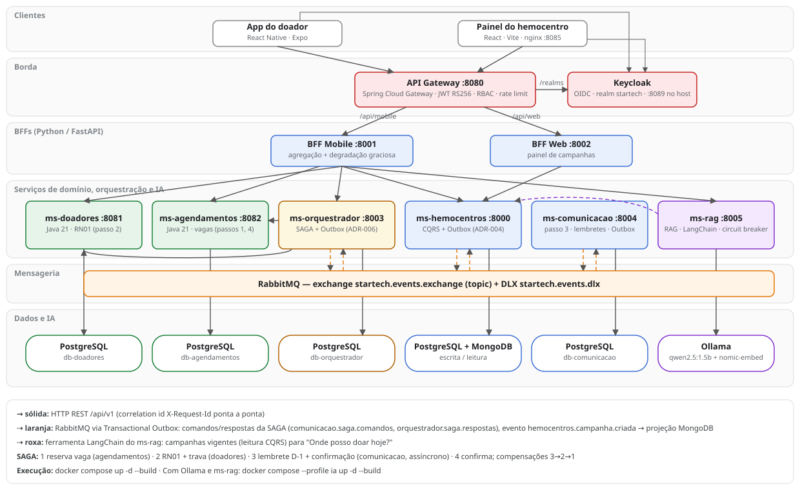

# StarTech

A **StarTech** propõe uma plataforma voltada ao contexto da doação de sangue no Brasil, com foco no apoio à mobilização e à fidelização de doadores e na aproximação entre doadores e serviços de hemoterapia.

## Contexto Acadêmico

- **Disciplina:** GCC129 – Sistemas Distribuídos
- **Curso:** Sistemas de Informação
- **Instituição:** Universidade Federal de Lavras (UFLA)
- **Semestre:** 2026/2

**Acesso rápido:** [Como executar](#como-executar) · [Concepção](./docs/concepcao.md) · [Diagrama da Arquitetura (Etapa 4)](./docs/arquitetura/diagrama-etapa4.svg) · [Diagrama da Parte 2](./docs/arquitetura/diagram.svg) · [Avaliação do RAG](./docs/ia/avaliacao-rag.md) · [Escalabilidade (Grafana k6)](./docs/escalabilidade/relatorio-escalabilidade-k6.md) · [Decisões Arquiteturais (ADRs)](./docs/arquitetura/Cat%C3%A1logo%20de%20Decis%C3%B5es%20Arquiteturais%20%28ADRs%29%20-%20StarTech.md) · [Contratos de API e HATEOAS](./docs/arquitetura/Especificac%CC%A7a%CC%83o%20de%20Contratos%20de%20API%20e%20HATEOAS%20-%20StarTech.md)

## Problema

A disponibilidade de sangue e hemocomponentes depende da realização contínua de novas doações, enquanto as necessidades dos serviços de hemoterapia podem variar ao longo do tempo.

Nesse contexto, o projeto considera como problema central a **dificuldade de manter uma mobilização contínua de doadores de sangue e alinhá-la às necessidades variáveis dos serviços de hemoterapia no Brasil**.

A fundamentação do problema, incluindo dados oficiais, evidências científicas, motivação e impacto social esperado, está disponível na [documentação de concepção](./docs/concepcao.md).

## Objetivo

O objetivo do projeto é desenvolver uma plataforma que apoie a comunicação entre serviços de hemoterapia e doadores, permitindo que necessidades de doação e campanhas sejam divulgadas e que os doadores possam acompanhar essas informações e manter um vínculo mais contínuo com a doação de sangue.

A solução busca atuar principalmente no apoio à **mobilização e à fidelização de doadores orientadas pelas necessidades comunicadas pelos serviços de hemoterapia**.

## Escopo da Solução

Em sua visão conceitual, a plataforma deverá oferecer suporte a atividades como:

- divulgação de necessidades de doação por serviços de hemoterapia;
- criação e divulgação de campanhas;
- acompanhamento de necessidades e oportunidades de doação pelos doadores;
- envio de avisos e lembretes relacionados à participação e ao retorno dos doadores;
- manifestação de interesse em campanhas;
- suporte ao agendamento de doações, quando aplicável;
- acompanhamento de informações relacionadas à mobilização, como interesse, agendamentos, comparecimentos e retorno de doadores.

A plataforma não tem como objetivo realizar a gestão completa dos estoques de sangue nem substituir os sistemas utilizados pelos serviços de hemoterapia.

Também não determinará se uma pessoa está apta a realizar uma doação, uma vez que essa avaliação depende dos critérios vigentes e da triagem realizada pelo serviço de hemoterapia responsável.

## Arquitetura da Solução

Para a Parte 2, a StarTech definiu uma arquitetura distribuída com **quatro microsserviços de domínio independentes**, cada um responsável por um conjunto específico de funcionalidades e com persistência própria. Essa divisão busca separar as operações de cadastro, campanhas, agendamentos e comunicação, permitindo tratar suas diferentes necessidades de maneira independente.

As tecnologias e os padrões descritos a seguir estão **implementados** neste repositório (Etapa 4), executáveis via Docker Compose.

### Visão Geral da Arquitetura



[Visualizar o diagrama da Etapa 4 separadamente](./docs/arquitetura/diagrama-etapa4.svg) · [Diagrama original da Parte 2](./docs/arquitetura/diagram.svg)

### Microsserviços de Domínio

| Microsserviço | Tecnologias e persistência | Responsabilidade principal |
| --- | --- | --- |
| **Doadores** (`doadores`) | Java 21, Spring Boot e PostgreSQL | Cadastro e perfil dos doadores, histórico e acompanhamento dos intervalos registrados entre doações. |
| **Hemocentros** (`hemocentros`) | Python, FastAPI, PostgreSQL e MongoDB | Gestão dos serviços de hemoterapia, campanhas e necessidades de doação, com modelos separados de escrita e leitura. |
| **Agendamentos** (`agendamentos`) | Java 21, Spring Boot e PostgreSQL | Gestão de horários e reservas de vagas; participante da SAGA de agendamento. |
| **Comunicação** (`comunicacao`) | Python, FastAPI e PostgreSQL | Participante do passo 3 da SAGA: programa o lembrete D-1, confirma o agendamento e responde ao orquestrador via Transactional Outbox; mantém o histórico de notificações. |

Além dos serviços de domínio, o **Orquestrador** (`orquestrador`, Python, FastAPI e PostgreSQL) é um microsserviço dedicado à coordenação da SAGA de agendamento: mantém o estado de cada transação distribuída e publica seus comandos pelo Transactional Outbox, sem regras de domínio próprias (ver ADR-006).

O **Assistente do doador** (`rag`, Python, FastAPI, LangChain e Ollama local) responde dúvidas sobre critérios de doação com base na Portaria de Consolidação MS nº 5/2017 (RAG) e informa as campanhas ativas, com limites de tempo, circuit breaker e fallback (ver ADR-007).

Cada microsserviço mantém sua própria persistência. No serviço `hemocentros`, o PostgreSQL é utilizado no modelo de escrita, enquanto o MongoDB mantém uma visão de leitura para consultas.

### Acesso pelos dois clientes

| Cliente | Acesso e conta de desenvolvimento | Operações |
| --- | --- | --- |
| [Painel dos hemocentros](./web-hemocentros/README.md) | Navegador em `http://localhost:8085`, usuário `operador1` | Criar, filtrar e consultar campanhas. |
| [Aplicativo do doador](./mobile-doador/README.md) | React Native com Expo, usuário `doador1` ou conta criada no aplicativo | Cadastrar o perfil, consultar campanhas e horários, agendar, acompanhar a SAGA e usar o assistente. |

Os clientes se autenticam no realm `startech` do Keycloak pelo fluxo Authorization Code com PKCE S256. O Gateway recebe o token Bearer e verifica o papel e a audiência antes de encaminhar as chamadas. O painel usa `startech-web` (papel `operador`, audiência `bff-web`) em `/api/web/**`. O aplicativo usa `startech-mobile` (papel `doador`, audiência `bff-mobile`) em `/api/mobile/**`. As contas de desenvolvimento e as opções de redirecionamento estão no [guia do Keycloak](./keycloak/README.md).

### Padrões de Sistemas Distribuídos

Os principais padrões definidos para a arquitetura são:

- **SAGA orquestrada:** o microsserviço dedicado `orquestrador` coordena uma transação de reserva que envolve `agendamentos`, `doadores` e `comunicacao`. A reserva provisória da vaga é seguida pela verificação do intervalo, pelo registro do lembrete e pela confirmação da reserva. Em caso de falha, o orquestrador coordena compensações para as operações reversíveis, como liberar a vaga e remover um bloqueio temporal. Essa verificação não substitui a avaliação clínica realizada pelo serviço de hemoterapia.
- **CQRS:** aplicado em `hemocentros`, separando as operações de escrita no PostgreSQL das consultas à visão de leitura no MongoDB. As alterações são propagadas de forma assíncrona por eventos, com **consistência eventual** entre os modelos.
- **Database per Service:** cada microsserviço é responsável pelos próprios dados, sem compartilhamento direto de seu banco com os demais serviços.
- **Transactional Outbox:** os serviços registram alterações de domínio e eventos na mesma transação local. Um processo separado publica os eventos no RabbitMQ, reduzindo o risco de inconsistência associado ao *dual write*. O `orquestrador` aplica o mesmo padrão às transições de estado da SAGA e aos comandos enviados a `comunicacao`.
- **HATEOAS:** implementado nos contratos REST de agendamento. Os links de navegação e ações disponíveis variam de acordo com o estado do agendamento, como confirmado ou cancelado.
- **RAG com resiliência:** o `rag` recupera trechos da Portaria MS nº 5/2017 e gera respostas restritas a esse contexto. Perguntas sobre locais de doação vão para uma ferramenta que lê as campanhas vigentes (CQRS). Na configuração do Compose, a recuperação tem limite de 3 s e a geração, de 10 s. O BFF espera até 14 s pelo RAG e pode devolver uma resposta de contingência.

Os detalhes das decisões, alternativas consideradas e fluxos de comunicação estão disponíveis no [catálogo de decisões arquiteturais](./docs/arquitetura/Cat%C3%A1logo%20de%20Decis%C3%B5es%20Arquiteturais%20%28ADRs%29%20-%20StarTech.md) e na [especificação de contratos de API](./docs/arquitetura/Especificac%CC%A7a%CC%83o%20de%20Contratos%20de%20API%20e%20HATEOAS%20-%20StarTech.md).

### Como executar

Na raiz do repositório, execute os comandos abaixo com Docker e o plugin Compose.

```sh
docker compose up -d --build
docker compose ps
```

Com a configuração padrão, o painel atende em `http://localhost:8085`, o Gateway em `http://localhost:8080` e o Keycloak em `http://localhost:8089`. Essa execução atende ao fluxo de campanhas e agendamento. Para incluir o assistente com inferência local, execute:

```sh
docker compose --profile ia up -d --build
docker compose --profile ia ps -a
```

O perfil `ia` acrescenta `ollama`, `ollama-pull` e `ms-rag`. Na primeira execução, o download dos modelos exige acesso à internet. O término de `ollama-pull` com código 0 é esperado. O serviço RAG constrói seu índice em memória. Sem esse perfil, o BFF Mobile mantém a rota do assistente disponível com resposta de contingência. As portas e os modelos podem ser ajustados seguindo o [exemplo de configuração](./.env.example).

**Como conferir uma campanha nos dois clientes**

1. Abra o painel como operador. Crie uma campanha com título identificável, início hoje, término hoje ou depois e o mesmo tipo sanguíneo do perfil do doador. Guarde o ID devolvido pelo `POST /api/web/campanhas` (HTTP 201).
2. Inicie o app seguindo o [guia do doador](./mobile-doador/README.md). No dispositivo físico, configure `EXPO_PUBLIC_API_URL` e `EXPO_PUBLIC_KEYCLOAK_URL` com endereços do servidor acessíveis pelo aparelho. Entre como doador e confira o tipo sanguíneo no perfil.
3. Após alguns segundos, abra novamente a tela inicial de modo que ela faça uma nova consulta. A campanha deve aparecer com o mesmo título e hemocentro. O ID em `campanhas` na resposta de `GET /api/mobile/home` deve coincidir com o do painel. Essa leitura vem da projeção em MongoDB atualizada via RabbitMQ.

O [roteiro da Parte 4](./docs/demonstracao.md) traz comandos e resultados esperados para a SAGA, as compensações, a projeção CQRS e o assistente. Use `scripts/demo/preparar.sh` apenas em um ambiente de demonstração: ele apaga agendamentos, horários e travas de elegibilidade antes de recriar a grade. Os testes automatizados têm scripts próprios para [SAGA](./scripts/e2e-saga.sh), [CQRS](./scripts/e2e-cqrs.sh) e [serviços Python](./scripts/test-docker.sh). A [avaliação do RAG](./docs/ia/avaliacao-rag.md) registra as medições e as condições do ensaio.

## Organização do Repositório

A documentação e os artefatos do projeto são mantidos neste repositório. Sua estrutura será ampliada à medida que novos documentos e componentes forem incorporados.

```text
.
├── docs/                    # concepção, ADRs, contratos, diagramas e avaliação do RAG (docs/ia/)
├── mobile-doador/           # aplicativo React Native / Expo
├── web-hemocentros/         # painel React / Vite servido por nginx
├── gateway/                 # API Gateway (Spring Cloud Gateway)
├── keycloak/                # Keycloak com o realm startech
├── bff-mobile/, bff-web/    # BFFs (Python / FastAPI)
├── ms-doadores/             # Java 21 / Spring Boot
├── ms-agendamentos/         # Java 21 / Spring Boot
├── ms-hemocentros/          # Python / FastAPI, CQRS (PostgreSQL + MongoDB)
├── ms-orquestrador/         # Python / FastAPI, SAGA + Transactional Outbox
├── ms-comunicacao/          # Python / FastAPI, passo 3 da SAGA, lembretes
├── ms-rag/                  # Python / FastAPI + LangChain + Ollama (RAG)
├── scripts/                 # testes, E2E e avaliação do RAG
├── compose.yaml             # execução local e perfil opcional ia
└── README.md
```

### Principais arquivos e diretórios

- [`docs/`](./docs) — documentação detalhada do projeto;
- [`docs/concepcao.md`](./docs/concepcao.md) — fundamentação do problema, motivação, impacto social esperado e esboço conceitual da solução;
- [`docs/arquitetura/`](./docs/arquitetura/) — decisões arquiteturais, contratos de API e diagramas de componentes;
- [`docs/ia/`](./docs/ia/) — avaliação do assistente RAG (com e sem RAG, latência, custo e resiliência);
- [OpenAPI](./docs/arquitetura/openapi.yaml) — métodos, parâmetros, respostas e erros das APIs;
- [`.gitignore`](./.gitignore) — definição de arquivos e diretórios que não devem ser versionados;
- [`LICENCE`](./LICENCE) — licença MIT do repositório;
- [`README.md`](./README.md) — visão geral e ponto de entrada do repositório.

## Documentação

| Documento | Descrição |
| --- | --- |
| [Concepção do Projeto](./docs/concepcao.md) | Identidade da startup, problema, motivação, impacto social esperado, solução conceitual e referências utilizadas. |
| [Catálogo de Decisões Arquiteturais (ADRs)](./docs/arquitetura/Cat%C3%A1logo%20de%20Decis%C3%B5es%20Arquiteturais%20%28ADRs%29%20-%20StarTech.md) | Justificativas e alternativas para a decomposição em microsserviços, SAGA, bancos independentes, outbox, CQRS, Gateway, BFFs, orquestrador dedicado (ADR-006) e IA com RAG (ADR-007). |
| [Especificação de Contratos de API e HATEOAS](./docs/arquitetura/Especificac%CC%A7a%CC%83o%20de%20Contratos%20de%20API%20e%20HATEOAS%20-%20StarTech.md) | Endpoints principais dos serviços e BFFs, versionamento, tratamento de erros e exemplos de respostas com links HATEOAS. |
| [Diagrama de Arquitetura (Etapa 4)](./docs/arquitetura/diagrama-etapa4.svg) | Componentes implementados: borda, BFFs, serviços, mensageria, bancos e IA. |
| [Diagrama de Arquitetura (Parte 2)](./docs/arquitetura/diagram.svg) | Projeto arquitetural original da Parte 2. |
| [Avaliação do RAG](./docs/ia/avaliacao-rag.md) | 5 perguntas com e sem RAG, latência, tokens, projeção de custo e teste de resiliência. |
| [Roteiro da Demonstração](./docs/demonstracao.md) | Passo a passo da Parte 4 com os comandos de `scripts/demo/` e o resultado esperado de cada critério. |
| [Relatório de Escalabilidade (Grafana k6)](./docs/escalabilidade/relatorio-escalabilidade-k6.md) | *(Histórico)* Teste de estresse e auto-scaling no Kubernetes (HPA 1 → 3 → 1 réplicas), painel geral e prints do Grafana k6. |


## Equipe

- [Diovani da Cruz](https://github.com/diovaniMangiajr)
- [Ezequiel Dominguez](https://github.com/Ez1309)
- [Matheus Freire Costa Pimenta](https://github.com/matheuspimenta3)
- [Thiago Vinícius](https://github.com/thiagovtr)
