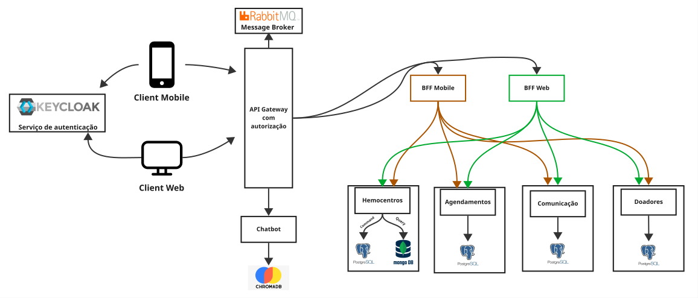

# StarTech

A **StarTech** propõe uma plataforma voltada ao contexto da doação de sangue no Brasil, com foco no apoio à mobilização e à fidelização de doadores e na aproximação entre doadores e serviços de hemoterapia.

## Contexto Acadêmico

- **Disciplina:** GCC129 – Sistemas Distribuídos
- **Curso:** Sistemas de Informação
- **Instituição:** Universidade Federal de Lavras (UFLA)
- **Semestre:** 2026/2

**Acesso rápido:** [Concepção](./docs/concepcao.md) · [Diagrama da Arquitetura](./docs/arquitetura/diagram.svg) · [Decisões Arquiteturais (ADRs)](./docs/arquitetura/Cat%C3%A1logo%20de%20Decis%C3%B5es%20Arquiteturais%20%28ADRs%29%20-%20StarTech.md) · [Contratos de API e HATEOAS](./docs/arquitetura/Especificac%CC%A7a%CC%83o%20de%20Contratos%20de%20API%20e%20HATEOAS%20-%20StarTech.md)

## Problema

A disponibilidade de sangue e hemocomponentes depende da realização contínua de novas doações, enquanto as necessidades dos serviços de hemoterapia podem variar ao longo do tempo.

Nesse contexto, o projeto considera como problema central a **dificuldade de manter uma mobilização contínua de doadores de sangue e alinhá-la às necessidades variáveis dos serviços de hemoterapia no Brasil**.

A fundamentação do problema, incluindo dados oficiais, evidências científicas, motivação e impacto social esperado, está disponível na [documentação de concepção](./docs/concepcao.md).

## Objetivo

O objetivo do projeto é desenvolver uma plataforma que apoie a comunicação entre serviços de hemoterapia e doadores, permitindo que necessidades de doação e campanhas sejam divulgadas e que os doadores possam acompanhar essas informações e manter um vínculo mais contínuo com a doação de sangue.

A solução busca atuar principalmente no apoio à **mobilização e à fidelização de doadores orientadas pelas necessidades comunicadas pelos serviços de hemoterapia**.

## Escopo da Solução

Em sua visão conceitual, a plataforma deverá oferecer suporte a atividades como:

- divulgação de necessidades de doação por serviços de hemoterapia;
- criação e divulgação de campanhas;
- acompanhamento de necessidades e oportunidades de doação pelos doadores;
- envio de avisos e lembretes relacionados à participação e ao retorno dos doadores;
- manifestação de interesse em campanhas;
- suporte ao agendamento de doações, quando aplicável;
- acompanhamento de informações relacionadas à mobilização, como interesse, agendamentos, comparecimentos e retorno de doadores.

A plataforma não tem como objetivo realizar a gestão completa dos estoques de sangue nem substituir os sistemas utilizados pelos serviços de hemoterapia.

Também não determinará se uma pessoa está apta a realizar uma doação, uma vez que essa avaliação depende dos critérios vigentes e da triagem realizada pelo serviço de hemoterapia responsável.

## Arquitetura da Solução

Para a Parte 2, a StarTech definiu uma arquitetura distribuída com **quatro microsserviços de domínio independentes**, cada um responsável por um conjunto específico de funcionalidades e com persistência própria. Essa divisão busca separar as operações de cadastro, campanhas, agendamentos e comunicação, permitindo tratar suas diferentes necessidades de maneira independente.

As tecnologias e os padrões descritos a seguir representam o **projeto arquitetural da solução**, que será implementado e integrado nas próximas etapas da disciplina.

### Visão Geral da Arquitetura



[Visualizar o diagrama de arquitetura separadamente](./docs/arquitetura/diagram.svg)

### Microsserviços de Domínio

| Microsserviço | Tecnologias e persistência | Responsabilidade principal |
| --- | --- | --- |
| **Doadores** (`doadores`) | Java 21, Spring Boot e PostgreSQL | Cadastro e perfil dos doadores, histórico e acompanhamento dos intervalos registrados entre doações. |
| **Hemocentros** (`hemocentros`) | Python, FastAPI, PostgreSQL e MongoDB | Gestão dos serviços de hemoterapia, campanhas e necessidades de doação, com modelos separados de escrita e leitura. |
| **Agendamentos** (`agendamentos`) | Java 21, Spring Boot e PostgreSQL | Gestão de horários e reservas de vagas, além da coordenação da SAGA de agendamento. |
| **Comunicação** (`comunicacao`) | Python, FastAPI e PostgreSQL | Processamento de notificações, confirmações e lembretes enviados aos doadores. |

Cada microsserviço mantém sua própria persistência. No serviço `hemocentros`, o PostgreSQL é utilizado no modelo de escrita, enquanto o MongoDB mantém uma visão de leitura para consultas.

### Acesso, Clientes e Comunicação

A solução prevê dois tipos de clientes, com necessidades distintas:

- **Cliente móvel do doador:** acesso a informações pessoais, campanhas, oportunidades de doação e agendamentos, por meio de um **BFF Mobile**.
- **Painel web dos serviços de hemoterapia:** cadastro e acompanhamento de campanhas e necessidades de doação, por meio de um **BFF Web**.

Ambos os BFFs foram projetados em **Python/FastAPI**, com interfaces planejadas em **React** (a forma final do cliente móvel, PWA ou React Native, ainda será definida). A autenticação e a gestão de identidade ficam a cargo do **Keycloak**, enquanto o **API Gateway** centraliza a entrada das requisições, a validação de acesso e o roteamento para os BFFs.

De forma simplificada, as requisições seguem o percurso **cliente → API Gateway → BFF correspondente → microsserviços de domínio**. A comunicação entre componentes combina **APIs REST versionadas** (`/api/v1/`) e processamento assíncrono de mensagens com **RabbitMQ**, conforme a necessidade de cada operação.

### Padrões de Sistemas Distribuídos

Os principais padrões definidos para a arquitetura são:

- **SAGA orquestrada:** o serviço `agendamentos` coordena uma transação de reserva que envolve também `doadores` e `comunicacao`. O fluxo prevê reserva provisória de vaga, verificação administrativa dos intervalos registrados entre doações, registro de lembrete e envio de confirmação. Em caso de falha, são previstas compensações para as operações reversíveis, como liberar a vaga e remover um bloqueio temporal. Essa verificação não substitui a avaliação clínica realizada pelo serviço de hemoterapia.
- **CQRS:** aplicado em `hemocentros`, separando as operações de escrita no PostgreSQL das consultas à visão de leitura no MongoDB. As alterações são propagadas de forma assíncrona por eventos, com **consistência eventual** entre os modelos.
- **Database per Service:** cada microsserviço é responsável pelos próprios dados, sem compartilhamento direto de seu banco com os demais serviços.
- **Transactional Outbox:** o projeto prevê o registro de alterações de domínio e eventos na mesma transação local. Um processo posterior publicará os eventos no RabbitMQ, reduzindo o risco de inconsistência associado ao *dual write*.
- **HATEOAS:** previsto nos contratos REST de agendamento. Os links de navegação e ações disponíveis variam de acordo com o estado do agendamento, como confirmado ou cancelado.

Os detalhes das decisões, alternativas consideradas e fluxos de comunicação estão disponíveis no [catálogo de decisões arquiteturais](./docs/arquitetura/Cat%C3%A1logo%20de%20Decis%C3%B5es%20Arquiteturais%20%28ADRs%29%20-%20StarTech.md) e na [especificação de contratos de API](./docs/arquitetura/Especificac%CC%A7a%CC%83o%20de%20Contratos%20de%20API%20e%20HATEOAS%20-%20StarTech.md).

### Evolução Prevista

As próximas etapas incluem a implementação dos serviços, sua containerização e orquestração, além da demonstração dos fluxos distribuídos. A integração posterior de **IA com RAG e LangChain**, apoiada em uma base de conhecimento do domínio, também está prevista no planejamento da solução.

## Organização do Repositório

A documentação e os artefatos do projeto são mantidos neste repositório. Sua estrutura será ampliada à medida que novos documentos e componentes forem incorporados.

```text
.
├── docs/
│   ├── arquitetura/
│   │   ├── Catálogo de Decisões Arquiteturais (ADRs) - StarTech.md
│   │   ├── Especificação de Contratos de API e HATEOAS - StarTech.md
│   │   └── diagram.svg
│   └── concepcao.md
├── .gitignore
├── LICENCE
└── README.md
```

### Principais arquivos e diretórios

- [`docs/`](./docs) — documentação detalhada do projeto;
- [`docs/concepcao.md`](./docs/concepcao.md) — fundamentação do problema, motivação, impacto social esperado e esboço conceitual da solução;
- [`docs/arquitetura/`](./docs/arquitetura/) — decisões arquiteturais, contratos de API e diagrama de componentes;
- [`.gitignore`](./.gitignore) — definição de arquivos e diretórios que não devem ser versionados;
- [`LICENCE`](./LICENCE) — licença MIT do repositório;
- [`README.md`](./README.md) — visão geral e ponto de entrada do repositório.

## Documentação

| Documento | Descrição |
| --- | --- |
| [Concepção do Projeto](./docs/concepcao.md) | Identidade da startup, problema, motivação, impacto social esperado, solução conceitual e referências utilizadas. |
| [Catálogo de Decisões Arquiteturais (ADRs)](./docs/arquitetura/Cat%C3%A1logo%20de%20Decis%C3%B5es%20Arquiteturais%20%28ADRs%29%20-%20StarTech.md) | Justificativas e alternativas para a decomposição em microsserviços, SAGA, bancos independentes, outbox, CQRS, Gateway e BFFs. |
| [Especificação de Contratos de API e HATEOAS](./docs/arquitetura/Especificac%CC%A7a%CC%83o%20de%20Contratos%20de%20API%20e%20HATEOAS%20-%20StarTech.md) | Endpoints principais dos serviços e BFFs, versionamento, tratamento de erros e exemplos de respostas com links HATEOAS. |
| [Diagrama de Arquitetura](./docs/arquitetura/diagram.svg) | Visão dos componentes, camadas e principais relações de comunicação da solução. |

A documentação será complementada conforme avançarem as etapas de implementação, containerização e integração do sistema.

## Equipe

- [Diovani da Cruz](https://github.com/diovaniMangiajr)
- [Ezequiel Dominguez](https://github.com/Ez1309)
- [Matheus Freire Costa Pimenta](https://github.com/matheuspimenta3)
- [Thiago Vinícius](https://github.com/thiagovtr)
