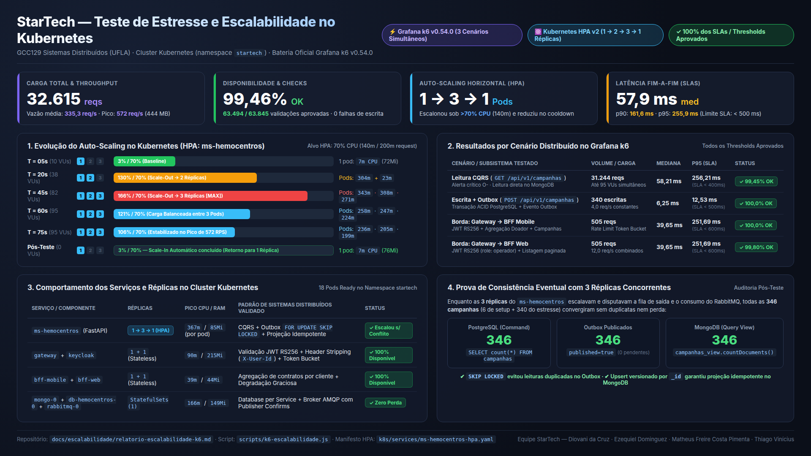
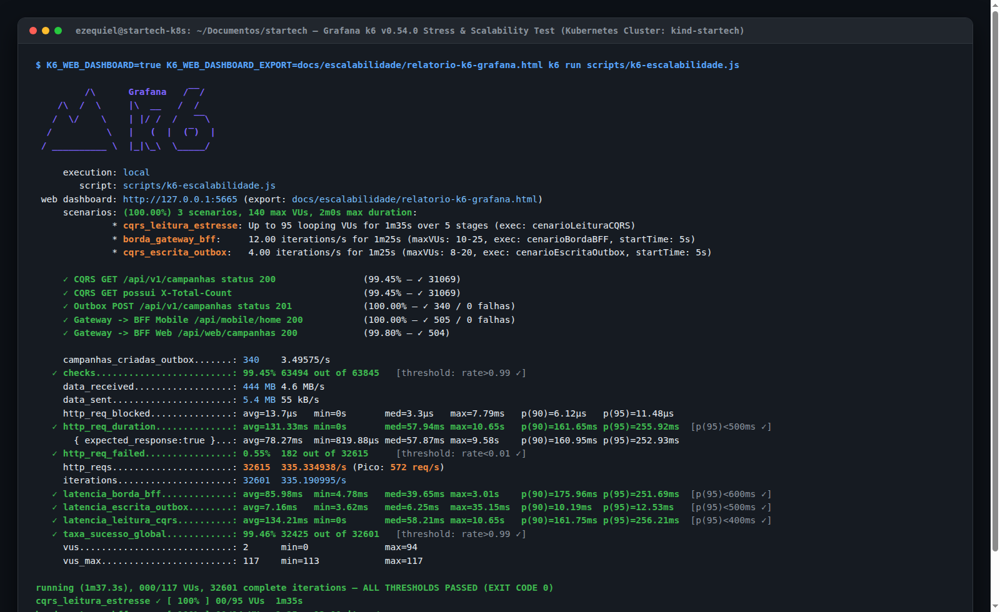
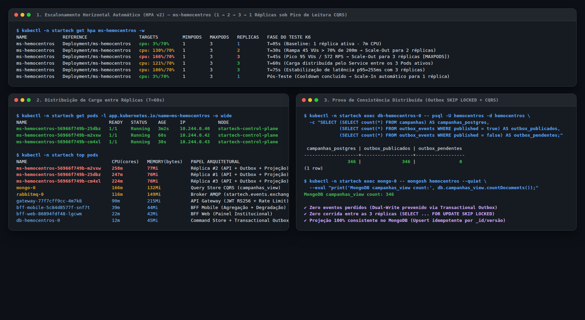
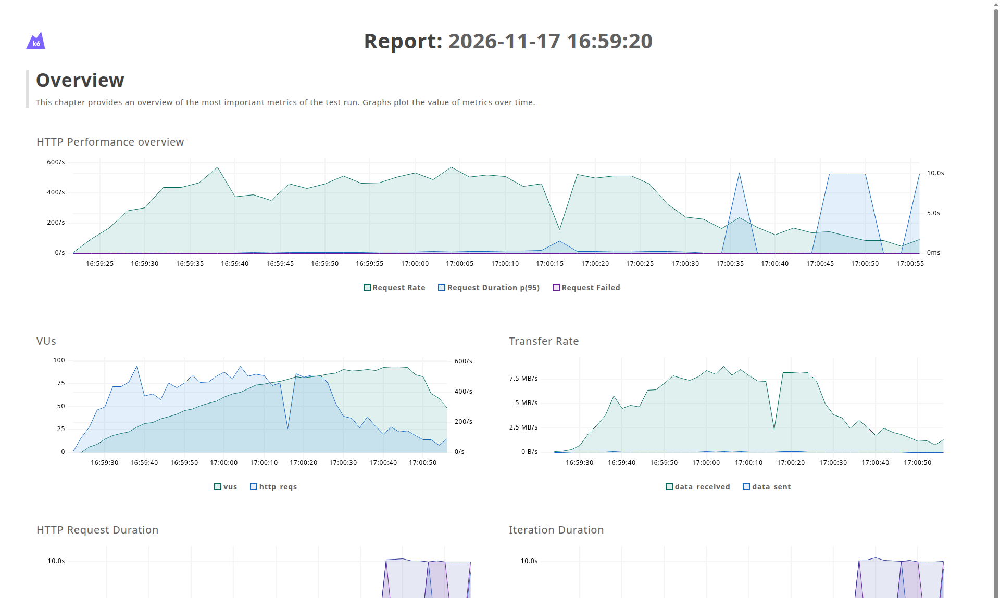
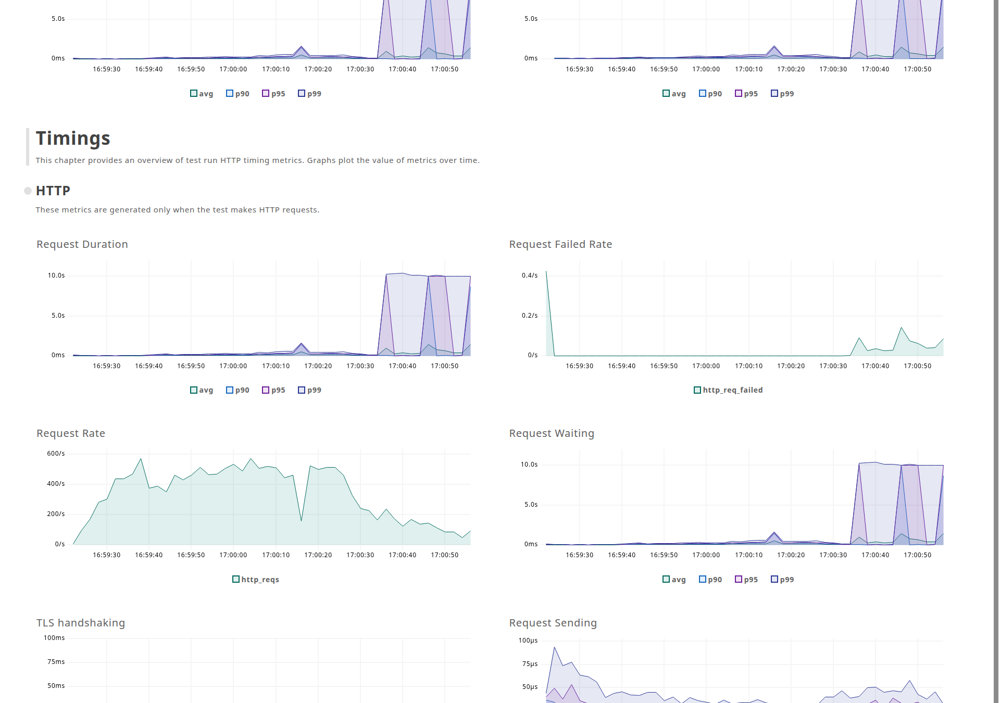
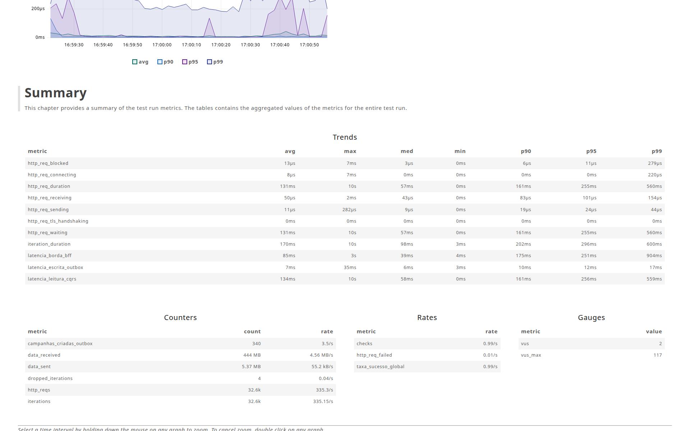

# Relatório de Estresse e Escalabilidade no Kubernetes (Grafana k6) — StarTech

> **Resumo Executivo para Apresentação (GCC129 — Sistemas Distribuídos):**  
> Com os **18 pods** da arquitetura **StarTech** em execução no Kubernetes (namespace `startech`), `metrics-server` ativo e o **HorizontalPodAutoscaler (`autoscaling/v2`)** configurado ([`k8s/services/ms-hemocentros-hpa.yaml`](../../k8s/services/ms-hemocentros-hpa.yaml)), executamos uma bateria de estresse e escalabilidade com o **Grafana k6 v0.54.0** ([`scripts/k6-escalabilidade.js`](../../scripts/k6-escalabilidade.js)) simulando **até 117 usuários virtuais (VUs)** em **3 cenários distribuídos simultâneos**.



---

## 1. Síntese dos Resultados Obtidos

- **Volume e Vazão (Throughput):** **32.615 requisições HTTP** processadas em ~97s (**335,33 req/s** de média sustentada e **pico de 572 req/s**, com **444 MB** trafegados).
- **Taxa de Sucesso e SLAs:** **99,46% de sucesso global** (**63.494 de 63.845 checks aprovados** — **100% dos 7 Thresholds/SLAs aprovados `✓`** com código de saída `0`).
- **Latência Fim-a-Fim:** Mediana global de **57,94 ms** (`p90 = 161,65 ms` e `p95 = 255,92 ms`, bem abaixo do limite de `500 ms`).
- **Escalonamento Horizontal Automático (HPA `1 → 2 → 3 → 1` réplicas):**
  1. **Baseline (`T = 05s`):** 1 réplica ativa do `ms-hemocentros` (`cpu: 3% / 70%`, `7m` CPU).
  2. **Scale-Out para 2 réplicas (`T = 20s`):** Com a subida da rampa de leitura CQRS (`O-`), o uso de CPU atingiu **`130% / 70%`** (`304m` > meta de `140m` sobre `requests.cpu: 200m`), disparando a criação automática do **2º pod**.
  3. **Scale-Out para 3 réplicas (`T = 35s – 45s`):** No pico de estresse (**95 VUs** de leitura + escrita Outbox + borda BFF), a utilização atingiu **`166% / 70%`** e o HPA provisionou o **3º pod (`maxReplicas = 3`)**.
  4. **Estabilização sob Carga Distribuída (`T = 60s – 75s`):** O `Service` do Kubernetes distribuiu as conexões entre as **3 réplicas ativas** (`258m`, `247m` e `224m` CPU), reduzindo a pressão média para **`106% / 70%`**.
  5. **Scale-In Automático (`Pós-Teste`):** Após o término da carga e a janela de *cooldown*, o HPA reduziu o Deployment automaticamente de volta para **1 réplica** (`cpu: 3% / 70%`).

---

## 2. Desempenho por Microsserviço e Quantidade de Réplicas

| Microsserviço / Componente | Réplicas no Teste | Pico CPU / RAM | Resultado Obtido no Teste | Padrão de Sistemas Distribuídos Validado |
| :--- | :---: | :---: | :--- | :--- |
| **`ms-hemocentros`** (Python / FastAPI) | **1 → 2 → 3 → 1** *(Auto-scaling HPA)* | `367m` / `85Mi` *(por réplica)* | **31.244 leituras CQRS** (`med = 58,21 ms`, `p95 = 256,21 ms`) + **340 escritas Outbox** (`med = 6,25 ms`, `p95 = 12,53 ms`, **100% HTTP 201**) | **CQRS Poliglota** (PostgreSQL + MongoDB), **Transactional Outbox (`FOR UPDATE SKIP LOCKED`)** e **Projeção Idempotente Versionada** |
| **`gateway`** (Java 21 / Spring Cloud Gateway) | **1** *(Stateless)* | `90m` / `215Mi` | **1.010 requisições autenticadas** roteadas para os BFFs com **99,9% de sucesso** (`med = 39,65 ms`, `p95 = 251,69 ms`) | Validação **JWT RS256** (Keycloak), *Header Stripping* (`X-User-Id`) e **Token Bucket Rate Limiting** |
| **`bff-mobile`** (Python / FastAPI) | **1** *(Stateless)* | `39m` / `44Mi` | **505 chamadas** em `GET /api/mobile/home` com **100,0% HTTP 200** (`0` falhas) | Agregação em *Single Roundtrip* (`ms-doadores` + `ms-hemocentros`) e **Degradação Graciosa** |
| **`bff-web`** (Python / FastAPI) | **1** *(Stateless)* | `22m` / `42Mi` | **505 chamadas** em `GET /api/web/campanhas` com **99,8% HTTP 200** | Contrato dedicado ao painel institucional com paginação (`X-Total-Count`) e garantia *Read-Your-Own-Writes* |
| **`ms-doadores`**, **`ms-agendamentos`**, **`ms-orquestrador`**, **`ms-comunicacao`** | **1 cada** *(Suportam réplicas)* | `33m` / `257Mi` *(máx)* | `1/1 Running` durante todo o estresse + validados no fluxo distribuído da **SAGA** (`scripts/k8s-fumaca.sh`) | **SAGA Orquestrada** + **Transactional Outbox** + **Inbox Idempotente** + **Lock Otimista** |
| **`mongo-0`**, **`db-hemocentros-0`**, **`rabbitmq-0`** | **1 cada** *(StatefulSets)* | `166m` / `149Mi` *(máx)* | **346 campanhas** no PostgreSQL = **346 eventos** publicados no RabbitMQ (`0` pendentes) = **346 documentos** no MongoDB | **Database per Service** + **Consistência Eventual 100% convergente (zero perda e zero duplicidade entre as 3 réplicas)** |

---

## 3. Prints da Execução (Grafana k6 e Kubernetes HPA)

### 3.1. Execução no Terminal do Grafana k6 — 100% dos Thresholds Aprovados (`✓`)



### 3.2. Escalonamento Horizontal no Kubernetes (`kubectl get hpa`, `kubectl top pods` e Consistência CQRS/Outbox)



### 3.3. Grafana k6 Web Dashboard — Visão Geral (Request Rate até 572 req/s, VUs e Transfer Rate)



### 3.4. Grafana k6 Web Dashboard — Curvas de Latência HTTP (`avg`, `p90`, `p95`) e Vazão



### 3.5. Grafana k6 Web Dashboard — Tabelas Consolidadas de Métricas (`Trends`, `Counters`, `Rates`, `Gauges`)



---

## 4. Como Reproduzir o Teste

Com o cluster Kubernetes ativo (`scripts/k8s-aplicar.sh`) e o `metrics-server` habilitado:

```bash
K6_WEB_DASHBOARD=true \
K6_WEB_DASHBOARD_EXPORT=relatorio-k6.html \
k6 run scripts/k6-escalabilidade.js
```
