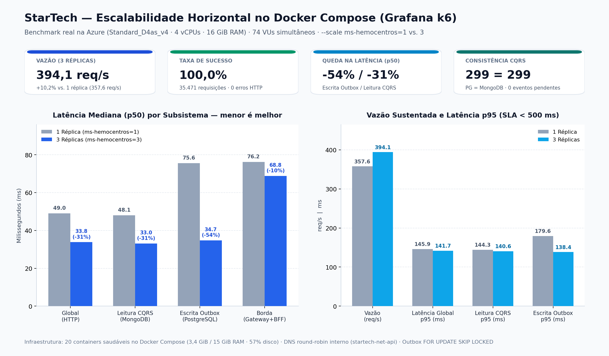

# Relatório de Estresse e Escalabilidade no Docker Compose (Grafana k6) — StarTech

> **Resumo Executivo (GCC129 — Sistemas Distribuídos):**  
> Com os **20 containers** da arquitetura **StarTech** em execução na VM em nuvem (**Azure `Standard_D4as_v4`**, 4 vCPUs, 16 GiB RAM, Ubuntu Linux, Docker Compose), executamos um benchmark comparativo de escalonamento horizontal com o **Grafana k6 v0.54.0** ([`scripts/k6-escalabilidade.js`](../../scripts/k6-escalabilidade.js) via [`scripts/rodar-escalabilidade-docker.sh`](../../scripts/rodar-escalabilidade-docker.sh)) simulando **até 74 usuários virtuais (VUs)** em **3 cenários simultâneos** (leitura CQRS, escrita concorrente Outbox e borda autenticada via API Gateway + BFF Mobile/Web).



---

## 1. Comparativo: 1 Réplica vs. 3 Réplicas (`--scale ms-hemocentros=3`)

| Métrica (45 s por rodada, até 74 VUs) | 1 Réplica (`ms-hemocentros=1`) | 3 Réplicas (`ms-hemocentros=3`) | Ganho / Resultado |
| :--- | :---: | :---: | :---: |
| **Requisições HTTP processadas** | 16.882 | **18.589** | **+10,1%** |
| **Vazão sustentada (Throughput)** | 357,62 req/s | **394,14 req/s** | **+10,2%** |
| **Taxa de sucesso HTTP / Checks** | **100,0%** | **100,0%** | **0 falhas** |
| **Latência Global — Mediana (p50)** | 49,01 ms | **33,79 ms** | **−31,1%** |
| **Latência Global — p90 / p95** | 116,59 / 145,89 ms | **104,86 / 141,73 ms** | **Abaixo de 150 ms** |
| **Leitura CQRS (MongoDB) — Mediana** | 48,06 ms | **33,05 ms** | **−31,2%** |
| **Escrita Outbox (PostgreSQL) — Mediana** | 75,57 ms | **34,74 ms** | **−54,0%** |
| **Escrita Outbox (PostgreSQL) — p95** | 179,57 ms | **138,41 ms** | **−22,9%** |
| **Borda Gateway + BFFs (JWT) — Mediana** | 76,17 ms | **68,77 ms** | **−9,7%** |
| **Consistência CQRS (PG = Outbox = Mongo)** | `153 = 153` (`0` pendentes) | **`299 = 299` (`0` pendentes)** | **100% convergente** |

---

## 2. O que o Teste Comprova na Arquitetura

1. **Escalonamento horizontal nativo com Docker Compose:** o comando `docker compose up -d --scale ms-hemocentros=3` sobe réplicas adicionais sem conflito de portas, com balanceamento *round-robin* pelo DNS interno da rede isolada `startech-net-api`.
2. **Ganho real de latência e vazão sob carga:** com 3 réplicas, a mediana de escrita no Outbox caiu **54%** (`75,57 ms → 34,74 ms`), a mediana de leitura CQRS caiu **31%** (`48,06 ms → 33,05 ms`) e a vazão subiu para **394,14 req/s** mantendo **100% de sucesso** (35.471 requisições totais sem nenhum erro).
3. **Zero duplicidade e zero perda no Transactional Outbox:** mesmo com 3 réplicas concorrentes publicando eventos simultaneamente (`FOR UPDATE SKIP LOCKED`), o estado final convergiu com exatidão: **299 campanhas no PostgreSQL = 0 eventos pendentes no Outbox = 299 documentos no MongoDB**.
4. **Eficiência de recursos na nuvem:** com todos os **20 containers** em execução (incluindo 7 bancos, RabbitMQ, Keycloak, Gateway, 2 BFFs, 6 microsserviços, Painel Web e Ollama), o consumo total da VM permaneceu em **3,4 GiB de 15 GiB de RAM** (12 GiB livres) e **57% de disco** (27 GB livres).

---

## 3. Como Reproduzir

Com a stack do Docker Compose no ar (`docker compose up -d`):

```bash
scripts/rodar-escalabilidade-docker.sh
```

O script executa automaticamente as duas rodadas (`1 réplica` e `3 réplicas`) usando a imagem oficial `grafana/k6:0.54.0` na rede `startech-net-api`, valida a consistência entre PostgreSQL e MongoDB e restaura `ms-hemocentros` para 1 réplica ao final.
